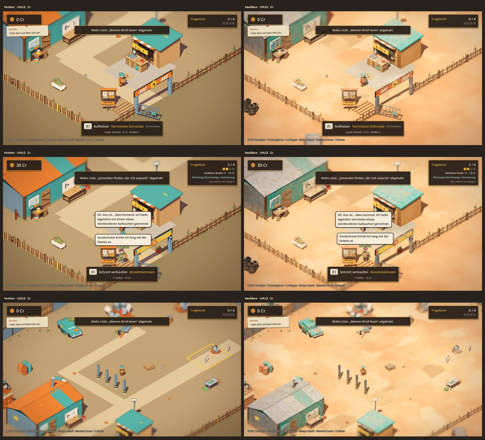
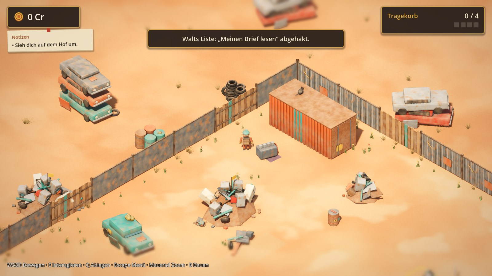

# Art style 2 – sun-baked junkyard (style sample)

Status: **style sample on branch `art-style-2`**, waiting for feedback before
the full conversion. Style 1 (flat toon colours with ink outline) is still the
default of the Blender tools; style 2 is opt-in via `SCRAP_STYLE=2`.





## Goal

Warm, sunny, high-quality isometric junkyard: weathered paint, rust at edges
and near the ground, sand dust on upward faces, soft contact shadows, dense
scenery around the plot. Scrapstead keeps its own charm (Walt's riveted
patches, Scrappy, slightly crooked objects, the warm colour palette).

## Pipeline

1. `tools/blender/kit.py` builds every model from the same primitives as
   before. With `SCRAP_STYLE=2`, `_finish()` assigns the procedural material
   from `tools/blender/style2.py` for the palette colour name instead of a flat
   toon colour.
2. `style2.PALETTE` maps each colour name to a material kind (paint, metal,
   rust, wood, rubber, glass, concrete, plant, fabric, paper, skin) and a base
   colour. `_weather()` layers sun bleaching, rust spots near edges and the
   ground, rust runs, vertical streaks, dirt at the bottom and sand dust on
   upward faces.
3. `style2.bake_root()` gives every merged mesh smart-projected UVs and bakes
   diffuse colour plus ambient occlusion (Cycles, GPU) into one texture per
   mesh (`TEXELS_PER_METRE`), stored next to the glb as JPEG.
4. Godot imports the glbs as usual; no shader work is needed for props.

Build everything:

```powershell
$env:SCRAP_STYLE = "2"; F:\_blender\blender.exe -b -P tools/blender/build_props.py -- --out assets/models --preview tests/_output/style2
```

`--only a,b,c` rebuilds a comma separated list. A full bake takes about
15–20 minutes on an RTX 3060.

Lessons from the sample:

- Edge chips based on Cycles *Pointiness* turned low-poly bevelled boxes into
  a camouflage pattern. They are switched off (`chips=0.0`); edge wear comes
  from the rust spots instead.
- Fractal noise with high detail reads as terrazzo speckle at game distance.
  All weathering noise uses low detail (2–3) and large scales.

## Ground and lighting

- `assets/shaders/ground_sand.gdshader`: world-space desert sand with drifts,
  grain, wind ripples, compacted patches and pebbles. Materials:
  `assets/materials/ground_sand.tres` (plot), `ground_outer.tres`
  (surroundings), `ground_path.tres` (paths), `ground_concrete.tres`.
  `tools/build_blockout.gd` uses the same materials.
- `assets/environment/yard_environment.tres`: ACES tonemapping, SSAO, SSIL,
  light glow, very light fog, slightly raised contrast and saturation. The sun
  in `OldYardTest.tscn` is warm with soft shadows.

## Scenery

`tools/blender/props_style2.py` adds purely decorative models: stacked car
wrecks (`car_stack_a/b/c`), a tyre tower, dry grass tufts and a scrap
mountain. `tools/make_scenery.py` scatters them outside the fence (and grass
along the inside of it) into `scenes/world/OutsideScenery.tscn`. The models
have no collisions, so navigation, the build grid and placement are not
affected.

## Open for the full conversion

- Characters (player, Juri, Scrappy) still need a pass for skin and fabric.
- The toon shader and outline material are still used by blockout walls and a
  few runtime meshes; they need style-2 replacements.
- Graphics quality settings (SSAO/SSIL/shadow quality) for weaker machines.
